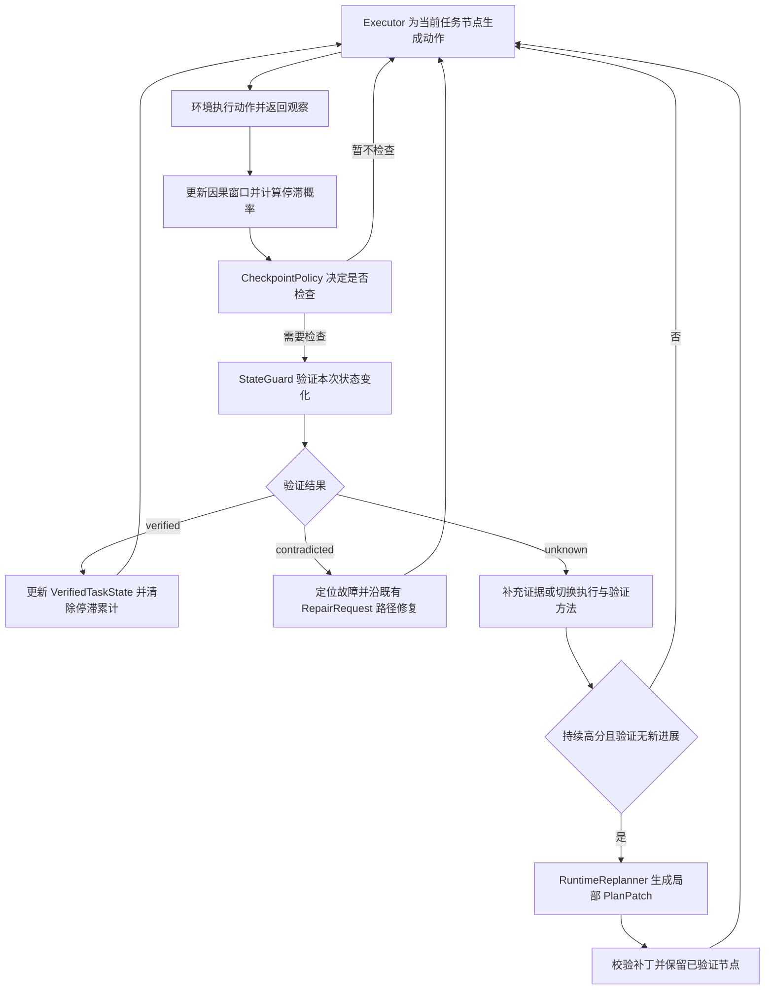

# 原版 StateGuard 小模型停滞评分接入指南

本文说明如何将 ModernBERT 停滞评分接入原版 StateGuard 的执行、检查点、验证和局部重规划流程。接入目标是：在持续无进展时提前检查，依据验证结果调整执行方式，必要时修订局部任务图。

接口依据原版 StateGuard 提交 `d137e70c7836960a2d4467c6fbc72ac5500dd2ae`。下文新增模块、配置和代码片段为实现约定，文件路径均相对于 StateGuard 仓库根目录。

## 1 接入后的执行流程



分两层使用停滞分数：第一层只决定是否增加一次一致性检查；第二层结合真实验证结果决定恢复方式。终态仍由节点证据和任务不变式判断。

## 2 文件与职责

| 文件 | 接入职责 |
|---|---|
| `stateguard/runtime/stagnation_scorer.py` 新增 | 加载编码器和分类头，返回停滞概率 |
| `stateguard/runtime/stagnation_window.py` 新增 | 将真实执行动作和公开观察整理成模型输入 |
| `stateguard/runtime/stagnation_policy.py` 新增 | 连续高分、去重、进展判断及冷却 |
| `stateguard/runtime/checkpoint_policy.py` | 在统一检查点调度中接收停滞信号 |
| `stateguard/runtime/episode_runner.py` | 动作后评分，验证后决策，分派恢复 |
| `stateguard/planning/runtime_replanner.py` | 复用 `LocalReplanRequest` 与 `RuntimeReplanner` |
| `stateguard/planning/patch_validator.py` | 复用 `apply_plan_patch()` 校验局部任务图修改 |
| `experiments/poc/runner.py` | 读取配置，构建评分器、策略和运行器 |

新增评分器采用独立的 StateGuard 模块，不依赖 StructAgent 对象、进度账本或规划器模式。

## 3 模型和参数准备

编码器使用 [answerdotai/ModernBERT-large 固定版本](https://huggingface.co/answerdotai/ModernBERT-large/tree/45bb4654a4d5aaff24dd11d4781fa46d39bf8c13)，分类头使用 [embedding-only NPZ 文件](https://raw.githubusercontent.com/Xiz233/StateGuard/8aa1e722a09651502b14ff8ac9accdbc82205ab3/integrations/structagent/heads/modernbert_large__causal_actions_and_observed_controls__embedding.npz)。头文件下载后可放到独立模型目录。

```text
models/
  ModernBERT-large/
    config.json
    model.safetensors
    tokenizer.json
    tokenizer_config.json
    special_tokens_map.json
  heads/
    modernbert_large__causal_actions_and_observed_controls__embedding.npz
```

文件校验：

```text
分类头 SHA256
74d06072aab2dcc6a907e9509e4c14003472a68c4168c0e7e68d2bea6e0b89f3

编码器 model.safetensors SHA256
44510fec5d3a81a1877f225637b869495f18e55f6f23a09abb9be0acc030295f
```

运行环境需要 CPU PyTorch、Transformers 和 NumPy。参考依赖组合为 Python 3.11、PyTorch 2.6.0 CPU、Transformers 4.57.6、NumPy 1.26.4。使用本地文件加载、`eval()` 和 `torch.inference_mode()`，在多个步骤间复用模型实例。

计算路径保持与分类头匹配：ModernBERT 输出均值池化为 1024 维表示，中心化后经 1024 × 8 投影与缩放，再由 8 个逻辑回归系数和截距输出 `p_stagnant`。

## 4 将原版观察和动作转换成输入窗口

窗口适配器接收 `EpisodeRunner.run()` 中的 `proposal`、实际 `executed` 动作、动作前 `obs` 和动作后 `after`。在 `env.step(executed)` 成功返回后更新窗口；执行失败的动作不能当成已经完成的动作加入历史。

| 原版数据 | 输入用途 |
|---|---|
| `task_spec["instruction"]` | 完整任务指令 |
| `proposal.subgoal_id` | 绑定当前任务节点，不作为停滞标签 |
| 实际 `executed` 动作 | 已执行动作文本，保留真实执行顺序 |
| `Observation.ui_tree` | 提取可见控件角色、文本和状态 |
| `Observation.visible_text` | 在定义好兼容格式后补充可见文本 |
| `Observation.step` 与运行步号 | 窗口排序及去重 |

实现 `to_control_rows(observation)`，将 UI 树统一成分类头对应的控件文本格式，例如：

```text
check-box\tEnable notifications\tvisible,checked
push-button\tSave\tvisible,enabled
```

若 `ui_tree` 是 XML、字典或列表，先解析为同一角色、文本、状态表示，再执行相同的清理、排序和截断。不要直接把整个 Python 对象的字符串表示送入编码器。缺少所需公开观察时返回历史不足；不要用环境隐藏状态、故障注入标签或评测答案填补。

保持以下窗口约定：

- 最近最多 8 条真实执行动作，每条文本最多 700 字符。
- 最近最多 3 帧有效辅助观察，至少有 2 帧时评分；每帧清理后最多 2000 字符。
- 任务片段前 256 token，动作片段末 640 token，待执行动作字段前 192 token，每帧观察前 300 token，再添加特殊 token。
- 在动作完成后的边界评分时，待执行动作字段为 `None`，编码时保留相同字段格式。

动作 `k` 后的观察也是动作 `k+1` 前的观察。统一这个时间索引约定，避免把动作之后的状态标成该动作之前的状态。每个窗口只含截至评分时已获得的信息。

定义中立的评分接口：

```python
score = scorer.score_window(
    instruction=task_spec["instruction"],
    actions=window.executed_actions,
    observations=window.observations,
    proposal=None,
)
# 返回 dict：status、p_stagnant、step、window_id、elapsed_ms。
```

## 5 用高分触发统一检查点

扩展 `CheckpointPolicy.evaluate()` 的可选参数，例如 `stagnation_signal=None`。在 `EpisodeRunner` 中先生成分数和触发信号，再将信号传入本轮唯一一次检查点调度。

检查点优先级：

1. FINISH、子目标完成和修复复核按原规则处理。
2. `dense` 按原规则每次动作后验证，评分不额外增加第二次 Guard 调用。
3. `sparse` 或 `hybrid` 在持续高分且冷却允许时，产生 `consistency` 检查。
4. 原有重复动作、长时间停留和因果风险检查继续适用。

新增检查点返回示例：

```python
return CheckpointDecision(
    should_verify=True,
    reason="model_stagnation",
    target_node=node_id,
    checkpoint_kind="consistency",
)
```

检查点真正执行后调用 `mark_checkpoint(node_id)`，统一更新冷却状态。FINISH 和完成复核不受小模型冷却限制。保留重复完成声明抑制逻辑，不用高分绕过“需要新证据”的约束。

随后沿本轮已有 Guard 路径执行：

```python
result = self.guard.verify_transition(
    task_state, obs, proposal, after,
    checkpoint_kind=decision.checkpoint_kind,
    candidate_nodes=candidates,
)
task_state.apply(result.state_updates)
adaptive_decision = apply_adaptive_result(node_id, result, step, after)
```

以上是调用顺序示意，应接在已有验证分支中，避免同一轮重复应用状态更新、重复记账或重复验证。`dense` 直接复用已有的 `result`。

## 6 根据验证结果选择恢复方式

在本轮 Guard 状态更新、自适应验证和修复处理完成后，调用停滞策略。策略不能只检查“节点还没完成”，还应检查是否出现新的有效证据或已验证的中间进展。

| 条件 | 决策 |
|---|---|
| Guard 为 `verified` 或确认新的有效进展 | 清空连续高分，继续执行 |
| Guard 为 `contradicted`，或已生成 `RepairRequest` | 优先使用原版故障定位与局部修复 |
| Guard 为 `unknown`，仍有可用证据获取方法 | 通过 `VerificationRequest` 或既有自适应上下文指导 Executor |
| 同一节点持续高分，验证后无新进展，替代执行或验证方法仍未解决 | 请求一次局部任务图重规划 |
| 评分无效、历史不足或模型不可用 | 清空高分累计，保留原执行路径 |

`unknown` 不等于已证实失败。不要单凭停滞概率调用 `propagate_failure()`、伪造 `contradicted`、给节点写入 `FAILED` 或 `UNVERIFIABLE`。

策略状态至少包括：

```text
scope = episode_id + node_id + node_generation
last_window_id
consecutive_high_windows
last_verified_evidence_signature
last_checkpoint_step
last_replan_step
```

同一窗口不重复计数。节点切换、新验证进展、任务重置或节点被 PlanPatch 替换时清理累计；替换后的节点使用新 generation。模型可跨任务复用，窗口和策略状态不能跨任务复用。

连续 2 个有效窗口和冷却 2 个动作步可作为初始策略参数。阈值应使用原版 StateGuard 轨迹的标注验证集选择，结合误触发率、停滞召回和额外调用成本确定，并保存到运行配置。

## 7 接入原版局部重规划

原版的入口是 `EpisodeRunner.run()` 内的局部函数 `attempt_local_replan()`，它负责预算、构造请求、应用补丁以及重映射运行状态。将停滞事件接到本轮末尾的 `revision_node` 分派位置。

调用顺序示意，`recovery` 和相关判断函数由接入模块实现：

```python
# 位于 run() 内，本轮验证和状态更新之后。
recovery = stagnation_policy.after_verification(
    node_id=proposal.subgoal_id,
    score=score,
    guard_result=result,
    task_state=task_state,
    adaptive_decision=adaptive_decision,
    active_repair=active_repair,
    step=step,
)

if (
    recovery.action == "local_replan"
    and revision_node is None
    and no_higher_priority_recovery_or_stop()
    and local_replan_budget_available(proposal.subgoal_id)
):
    pending_stagnation_context = recovery.to_dict()
    revision_node = proposal.subgoal_id

# 先保留本轮日志和 trace，再执行本轮已有的重规划分派。
obs = after
if revision_node is not None:
    if attempt_local_replan(revision_node, step, obs):
        continue
```

这段逻辑需纳入已有的控制流，保留硬停止条件的优先级。`attempt_local_replan()` 是 `run()` 内部函数，不能当作 `runner.attempt_local_replan()` 从外部调用。

构造 `LocalReplanRequest` 时，将停滞概率、触发窗口、未完成节点、尝试过的方法及验证缺口放进 `trace_summary["stagnation"]`。不要只把这些内容写进外部日志；它们必须进入实际重规划请求。维持原 `trace_summary` 的其他字段，并继续传递祖先边界、后继边界、环境能力和 `protected_verified_nodes`。

复用以下调用链：

```text
attempt_local_replan
  → LocalReplanRequest
  → RuntimeReplanner.replan
  → PlanPatch
  → apply_plan_patch
  → 更新 VerifiedTaskState 并重映射相关运行状态
```

补丁不得削弱任务不变式或覆盖受保护的已验证节点。补丁接受后，除了既有运行状态重映射，还要清理被替换节点的停滞窗口、累计和待处理事件。补丁失败或重规划预算耗尽时，沿原有失败或停止路径记录原因。

## 8 新增配置和启动器参数

在配置中增加独立的 `stagnation` 节，例如：

```yaml
stagnation:
  enabled: true
  model_dir: /absolute/path/to/ModernBERT-large
  head_path: /absolute/path/to/classifier.npz
  threshold: null             # 填入原版验证集选定的数值
  patience: 2
  checkpoint_cooldown_steps: 2
  replan_cooldown_steps: 4
  min_observations: 2
  device: cpu

runtime_replanning:
  enabled: true
  max_replans_per_node: 2
  max_replans_per_episode: 5

adaptive_verification:
  enabled: true
```

`stagnation` 是新增配置，需要在 `experiments/poc/runner.py` 中显式解析并传给扩展后的 `EpisodeRunner`。`threshold: null` 是待填写项，启用时必须拒绝空值、非有限值或范围外数值。冷却值和预算值是接入示例，应记录实际采用值。

原启动器将 `RuntimeReplanner` 的创建放在自适应验证初始化分支中，使用该启动器时应启用 `adaptive_verification`，并确认 `runtime_replanner` 实例实际传入运行器。若通过其他入口构造 `EpisodeRunner`，也要完成相同的对象注入。

构造接口示意：

```python
runner = EpisodeRunner(
    executor=executor,
    guard=guard,
    adaptive_controller=adaptive_controller,
    runtime_replanner=runtime_replanner,
    stagnation_scorer=scorer,       # 新增构造参数
    stagnation_policy=policy,       # 新增构造参数
    # 其他既有运行参数继续传入。
)
```

`verification.policy` 沿用实验选定的 `dense`、`sparse` 或 `hybrid`，不因接入小模型而自动切换。时间、token、Guard 调用、动作和修复预算继续使用共同控制层。

## 9 日志与验收

建议分别记录 `stagnation_scores.jsonl` 和 `stagnation_decisions.jsonl`，并用任务、节点 generation、step 和 window_id 关联已有 checkpoint、Guard、repair 和 plan_patch 事件。

决策字段至少包含：分数、阈值、连续次数、是否新增有效证据、Guard 判断、触发检查点、请求的恢复动作、实际执行的恢复动作及预算状态。将“请求重规划”和“补丁成功应用”分开记录。

验收清单：

| 场景 | 预期结果 |
|---|---|
| 持续高分，且稀疏策略本轮原本不检查 | 新增一次一致性检查 |
| dense 策略遇到高分 | 复用本轮 Guard 结果，不重复调用 |
| 高分但 Guard 确认进展 | 清空累计，不请求重规划 |
| Guard 判定矛盾并生成修复请求 | 进入原版修复流程 |
| 持续高分且验证无进展，替代方法仍未解决 | 在预算内请求局部 PlanPatch |
| 重复完成声明缺少新证据 | 保留原有抑制和验证债务处理 |
| 相同窗口重复调用 | 不重复累计、检查或重规划 |
| 节点被补丁替换或任务重置 | 清理旧窗口及待处理事件 |
| 模型不可用或缺少公开观察 | 使用原执行路径 |
| 修复、重规划或共同预算耗尽 | 按既有预算结束，不额外延长运行 |

最终检查完整链路：动作后观察 → 停滞评分 → 统一检查点 → Guard 证据判断 → 执行策略调整或局部 DAG 重规划 → 后续节点验证。评估时同时记录任务得分、正常完成情况、误触发、模型请求、token、控制器内存和耗时。
