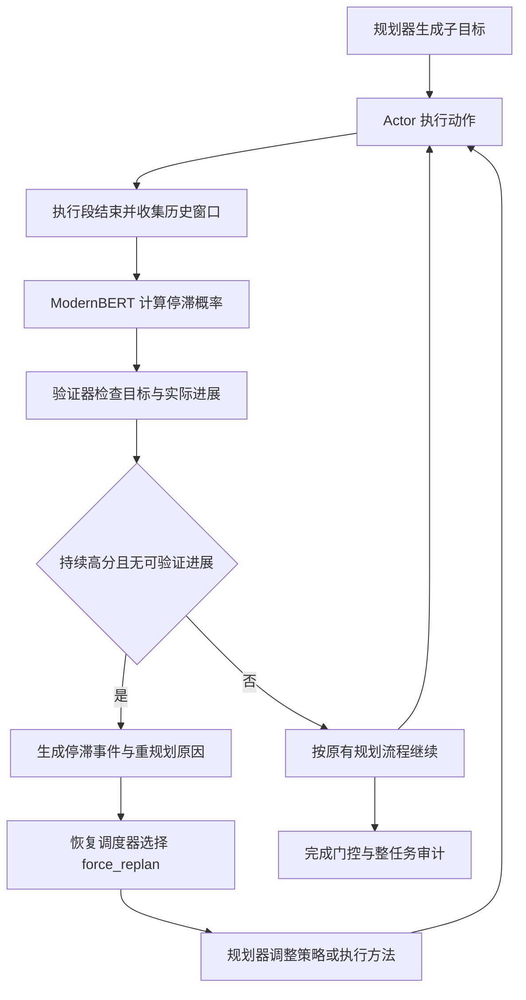

# 小模型停滞评分接入指南

本文给出将 ModernBERT 停滞评分接入 StructAgent 与 StateGuard 融合架构的方法：用评分识别持续无进展的执行窗口，结合验证结果触发重规划，让规划器调整后续策略。

下文的配置项、接口和代码片段是接入实现约定。文件路径以准备好的 StructAgent 融合源码目录为基准；在 StateGuard 仓库中维护修改时，应同步到 `integrations/structagent/overlay/` 下的对应路径。

## 1 接入后的执行流程



评分发生在 Actor 执行段结束、渐进验证开始之前；决策发生在该轮验证完成之后。这样可以区分“模型认为可能卡住”和“验证器已经确认取得进展”，避免依据过早的分数中断有效执行。

## 2 准备模型和分类头

| 文件 | 获取位置 |
|---|---|
| ModernBERT 编码器 | [answerdotai/ModernBERT-large 固定版本](https://huggingface.co/answerdotai/ModernBERT-large/tree/45bb4654a4d5aaff24dd11d4781fa46d39bf8c13) |
| PCA 与逻辑回归分类头 | [下载 NPZ](https://raw.githubusercontent.com/Xiz233/StateGuard/8aa1e722a09651502b14ff8ac9accdbc82205ab3/integrations/structagent/heads/modernbert_large__causal_actions_and_observed_controls__embedding.npz) |

编码器目录包含 `config.json`、`model.safetensors`、`tokenizer.json`、`tokenizer_config.json` 和 `special_tokens_map.json`。

分类头 SHA256：

```text
74d06072aab2dcc6a907e9509e4c14003472a68c4168c0e7e68d2bea6e0b89f3
```

编码器 `model.safetensors` SHA256：

```text
44510fec5d3a81a1877f225637b869495f18e55f6f23a09abb9be0acc030295f
```

使用 CPU PyTorch、Transformers 和 NumPy。可参考已验证的依赖组合：Python 3.11、PyTorch 2.6.0 CPU、Transformers 4.57.6、NumPy 1.26.4。模型在控制器进程中惰性加载并复用，无需单独启动推理服务。

## 3 将评分结果返回给控制器

修改 `mm_agents/structagent/core/final_audit/stagnation.py`，将评分与日志封装成 `score_stagnation()`，返回结构化记录。可复用 `StagnationScorer`、`recent_actions()`、`recent_observations()` 和 `load_scorer()`。

接口约定：

```python
def score_stagnation(agent, step, outcomes, history, current) -> dict:
    """Collect the causal window, score it, record it, and return the result."""
    # 复用窗口构造、模型加载和分类过程。
    # 记录日志后返回同一份 record。
    ...
    return record
```

成功记录示例，数值仅用于说明字段：

```json
{
  "status": "scored",
  "step": 12,
  "outcome_ids": ["goal_1"],
  "p_stagnant": 0.86,
  "observation_steps": [10, 11, 12],
  "action_count": 8,
  "elapsed_ms": 120.0
}
```

只接受有限且位于 `[0, 1]` 的分数。历史不足返回 `insufficient_history`，加载或推理失败返回 `unavailable`；这两种结果均不作为高分或低分样本累计。

保留匹配分类头的输入与数值处理：任务、已执行动作和已有辅助观察 → ModernBERT 均值池化 → 1024 维表示 → 中心化 → 8 维 PCA 投影与缩放 → 逻辑回归 → sigmoid。不要引入未来观察或原生评分器结果作为在线输入。

## 4 增加停滞触发策略

新增 `mm_agents/structagent/core/final_audit/stagnation_policy.py`，实现一个按任务和子目标隔离的 `StagnationPolicy`。接口示意如下，具体状态管理按下表实现：

```python
decision = policy.observe(
    scope_id=scope_id,
    window_id=window_id,
    score=score_record,
    verified_outcome_ids=verified_ids_after_check,
    progress_events=new_verified_progress_events,
    pending_outcome_ids=pending_ids_after_check,
    step=step_idx,
)
# decision.action: "continue" 或 "request_replan"
# decision.reason: 重规划原因
```

| 状态 | 用途 |
|---|---|
| `scope_id` | 标识一次子目标执行，绑定任务、子目标实例和稳定的目标集合 |
| `last_window_id` | 排除同一观察和动作窗口的重复计数 |
| `last_verified_ids` | 识别相较上次窗口新获得的验证结果 |
| `high_streak` | 同一子目标连续高停滞概率的有效窗口数 |
| `last_trigger_step` | 执行冷却，避免连续请求重规划 |

每个新窗口按以下顺序处理：

1. 任务或子目标实例变化时重置状态。`scope_id` 不应随剩余未完成目标列表的缩减而变化。
2. 若验证确认新增目标完成或新的可验证进展，清空高分累计；若所有目标都已证实，撤销待处理的停滞事件。
3. 重复窗口不计数；历史不足、评分不可用或分数非法时清空高分累计，并保留原执行路径。
4. 分数达到阈值则累计，否则清零。
5. 当仍有未完成目标、连续高分达到要求且冷却期已过时，返回 `request_replan`；触发后清空累计并记录触发步。

初始接入可以采用连续 2 个有效窗口、冷却 2 个环境步的策略参数。它们是待评估的起点。分数阈值应使用按任务划分的标注验证集，根据停滞召回、误触发率和额外调用成本选择，并随模型及分类头版本保存。

## 5 在 Actor 退出边界连接评分与验证

主要修改 `mm_agents/structagent/loop.py` 的 `_run_boundary_verify()` 与 `_verify_actor_loop_exit_for_planner()`。

调用顺序示意，辅助函数由接入代码实现：

```python
# Actor 执行段退出，目标列表保持本次子目标的稳定标识。
scope_id = get_subgoal_scope(agent)
score = score_stagnation(agent, step, outcomes, history, current)

# 继续原有验证，允许它更新账本；不要吞掉预算停止信号。
recover_pending(agent, env, obs, step, outcomes, "actor_boundary")

# 从更新后的账本重新读取状态，不复用验证前的 pending 列表。
decision = agent._stagnation_policy.observe(
    scope_id=scope_id,
    window_id=build_window_id(scope_id, score),
    score=score,
    verified_outcome_ids=read_verified_ids(agent, scope_id),
    progress_events=read_new_progress_events(agent, scope_id),
    pending_outcome_ids=read_pending_ids(agent, scope_id),
    step=step,
)

if decision.action == "request_replan":
    agent._pending_stagnation_replan = {
        "scope_id": scope_id,
        "step": step,
        "reason": decision.reason,
    }
```

同一边界只执行一次策略更新。若评分和验证分布在两个方法中，可返回内部结果对象或传递本次调用的记录；不要通过重新读取日志文件传递分数，也不要让上一轮结果泄漏到下一轮。

停滞策略使用验证后的账本变化判断进展。目标仍未完成并不等于没有进展，单纯的鼠标移动、焦点变化或界面动画也不算已证实进展。

## 6 接入恢复调度与规划器

修改 `mm_agents/structagent/core/recovery/dispatcher.py` 的 `_decide_planner_mode_and_reason()`：保留原有失败、完成拒绝和预算规则的优先级，在进入普通 `progress_check` 之前消费有效的停滞事件。

```python
# 放在既有高优先级规则之后、默认 progress_check 返回之前。
event = self._consume_stagnation_replan(step_idx)
if event is not None:
    self._force_replan_category = "stagnation_detected"
    return "force_replan", event["reason"]

return "progress_check", None
```

`_consume_stagnation_replan()` 应检查事件仍属于当前任务和子目标、窗口未过期、目标仍未取得新进展，随后一次性消费事件。更高优先级恢复接管、子目标切换或任务重置时，要撤销旧事件。

还需同步以下位置：

- `core/recovery/transitions.py`：在 `Transition` 和 `STUCK_CATEGORIES` 中加入 `stagnation_detected`。
- `core/planner/prompts.py`：为该类别增加提示，要求检查执行方法并选择不同策略，避免直接重复同一动作序列。
- `core/planner/planner.py`：确认类别和原因进入 `force_replan` 提示，必要时扩展类别映射。
- `loop.py`：在任务初始化和重置时创建或清理策略实例及待处理事件。

重规划原因建议包含以下信息：

```text
当前子目标连续两个有效执行窗口呈现高停滞概率，
且验证未确认新的目标进展。
请结合未完成目标、最近动作和验证证据调整执行方法；
不要原样重复此前动作序列。
```

停滞分数用于选择恢复路径；目标验证、最终 DONE 门控及整任务审计继续按证据判断。保留共同时间、token、请求和内部验证预算。不要因触发停滞恢复而额外补发一次规划器调用，应复用本轮已有的规划阶段。

## 7 增加启动配置

将以下新增配置接入启动器和控制器初始化，并在任务开始时记录解析后的实际值：

```bash
export FUSION_PROGRESSIVE=1
export FUSION_STAGNATION_MODE=gate
export FUSION_STAGNATION_MODEL_DIR=/absolute/path/to/modernbert_large
export FUSION_STAGNATION_HEAD=/absolute/path/to/classifier.npz
export FUSION_STAGNATION_THRESHOLD="${CALIBRATED_STAGNATION_THRESHOLD:?请设置验证集选定的阈值}"
export FUSION_STAGNATION_PATIENCE=2
export FUSION_STAGNATION_COOLDOWN_STEPS=2
export HF_HUB_OFFLINE=1
export TRANSFORMERS_OFFLINE=1
```

`FUSION_STAGNATION_MODE` 约定支持 `off` 和 `gate`。启动器检查模型路径、阈值范围、正整数累计次数及非负冷却步数；控制器根据模式调用评分与策略。阈值变量为空或解析失败时应在启动阶段报错，避免静默使用不明确的默认值。

在融合覆盖层中新增或修改恢复模块后，运行仓库的 `scripts/setup_structagent_fusion.py`，生成一个新的目标目录，并检查 `FUSION_SOURCE.json`。将配置与源码版本一同保存，便于复现。

## 8 记录决策并验证接入

新增 `stagnation_decisions.jsonl`，将评分、策略判断和实际执行的重规划关联起来。建议字段：

```json
{
  "scope_id": "task_1/subgoal_2/instance_1",
  "step": 12,
  "p_stagnant": 0.86,
  "threshold": 0.80,
  "high_streak": 2,
  "verified_progress": false,
  "decision": "request_replan",
  "planner_mode": "force_replan",
  "category": "stagnation_detected"
}
```

上述概率和阈值仅为格式示例。事件产生时记录 `decision`；调度器真正消费事件后再记录或关联 `planner_mode`，不要把重规划请求直接当成已执行重规划。

验收时至少覆盖以下情况：

| 输入与状态 | 预期行为 |
|---|---|
| 单次高分 | 累计一次，继续执行 |
| 同一子目标连续两个新窗口高分且无进展 | 触发一次 `force_replan` |
| 高分后验证确认有进展 | 清空累计，不触发 |
| 同一窗口重复调用 | 不重复累计或触发 |
| 冷却期内再次满足高分条件 | 不再次触发 |
| 评分不可用或历史不足 | 清空累计，继续原有路径 |
| 切换子目标或重置任务 | 清理旧状态与待处理事件 |
| 原有高优先级恢复规则命中 | 使用既有恢复规则并撤销过期停滞事件 |

最后检查一条完整链路：有效分数返回 → 连续高分且无进展 → 创建停滞事件 → 调度器消费 → 规划器收到 `stagnation_detected` 原因 → 生成后续计划。实验记录同时保留原生任务得分、正常完成情况、误触发次数、模型请求、token 和时间开销。
